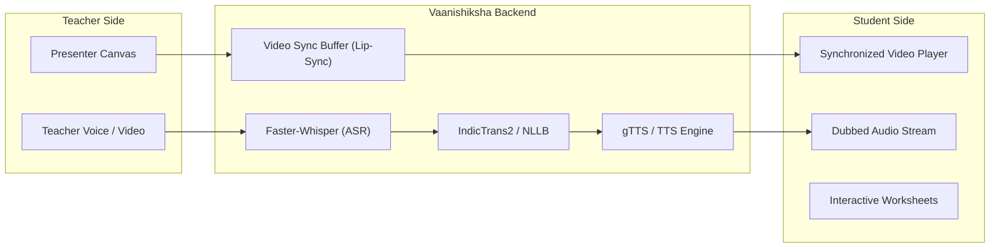

# Vaanishiksha (Mother-Tongue Primary Education Platform)

[](.github/workflows/ci.yml)
[](https://fastapi.tiangolo.com/)
[](https://react.dev/)
[](https://www.typescriptlang.org/)
[](LICENSE)

Breaking language barriers in Indian primary education through on-demand lecture dubbing, automated multilingual worksheets, and real-time live classroom translation with lip-sync synchronization.

---

## 🌟 Key Features

1. **On-Demand Dubbed Lectures:**
   - Teachers upload recorded lectures in any language.
   - Students listen to lectures dubbed automatically in their mother tongue with synchronized audio tracks.

2. **Real-Time Live Classroom Sync:**
   - Low-latency live classes featuring an intelligent video buffer to preserve lip-sync timing between translated audio and teacher camera frames.
   - Dual-channel doubt asking via voice and text translated on the fly.

3. **Automated Multilingual Worksheets:**
   - Auto-generates NCERT-aligned practice worksheets and quizzes translated into the student's regional language.

4. **NCERT Curriculum Integration:**
   - Structured curriculum explorer supporting primary grades (Classes 1–8) across Indian educational boards.

---

## 🏗️ Architecture Overview



---

## 🚀 Quickstart Guide

### Prerequisites
- **Python:** 3.10 or 3.11
- **Node.js:** 18 or 20+
- **Database:** SQLite (default for development) or PostgreSQL

---

### Backend Setup

```bash
# 1. Navigate to backend directory
cd back

# 2. Create virtual environment
python -m venv venv
# On Windows:
.\venv\Scripts\activate
# On Linux/macOS:
source venv/bin/activate

# 3. Install dependencies
pip install -r requirements.txt

# 4. Copy environment configuration
cp .env.example .env

# 5. Start the FastAPI development server
uvicorn app.main:app --reload --port 8000
```
API Documentation will be available at: `http://localhost:8000/docs`

---

### Frontend Setup

```bash
# 1. Navigate to frontend directory
cd frontend

# 2. Install dependencies
npm install

# 3. Start Vite dev server
npm run dev
```
Open your browser at: `http://localhost:5173`

---

## 🧪 Testing

```bash
# Backend pytest suite
cd back
pytest -v

# Frontend TypeScript check and build
cd frontend
npm run build
```

---

## 🤝 Contributing

1. Fork the repository.
2. Create your feature branch (`git checkout -b feat/my-feature`).
3. Commit your changes (`git commit -m "feat: add feature"`).
4. Push to your branch (`git push origin feat/my-feature`).
5. Open a Pull Request for review.
